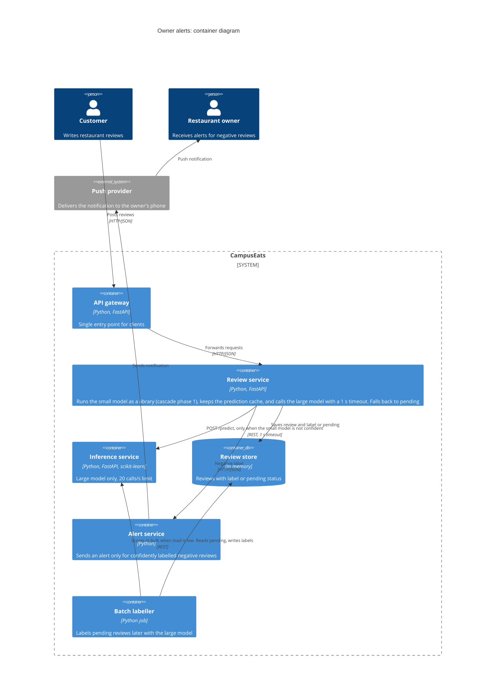

# Task 4: Deployment topologies and trade-offs

**Name:** Winit Pongsripian

**Student ID:** 01326171

This is **individual work**: each student completes and submits their own copy, in their own fork.

Design a deployment for the scenario below. Use your measurements from Tasks 0–3 as evidence: cite run names from `results/runs.csv`. Answer in English.

## Scenario: Owner alerts

When a customer posts a negative review, the restaurant owner gets a push notification within **2 seconds**. At the lunch peak, CampusEats receives **40 reviews per second**. A missed alert is acceptable, but a wrong alert (for example, "your customer is unhappy" when they are happy) makes owners stop trusting alerts and, in the end, ignore them.

Facts:

- The large model serves at most **20 calls per second** (4 calls at once × about 200 ms each), and every call costs money.
- The small model is fast and cheap enough to run anywhere, including inside the review service, but it is much less accurate on its own.

## Topologies and patterns to choose from

| | Topology | Where the model runs |
|---|---|---|
| T1 | Model as a service, synchronous | Inference service, called for each review (today's baseline) |
| T2 | Model as a library | Inside the review service, or on the device |
| T3 | Hybrid | Small model locally, large model as a remote service |
| T4 | Asynchronous / batch | Reviews are queued or stored, and scored later in bulk |

Combine one topology with any of the patterns from Tasks 1–3: **fallback**, **cascade** and **cache**.

## 1. Quality requirements

The three most important quality requirements for this scenario, each with a number where possible.

| # | Quality | Requirement |
|---|---|---|
| 1 | Trust in alerts (accuracy) | Wrong alerts must be rare. Target: at least 93% of labelled reviews correct (as measured in `t3-cache`), and a review that cannot be labelled reliably must fail silently (sending no alert) rather than risk a false positive. |
| 2 | Latency | 95% of negative-review alerts must reach the owner within 2 s at a peak load of 40 reviews/s. The classification label must be ready in well under 1 s to leave sufficient time for the downstream push notification. |
| 3 | Capacity and cost | The system must not exceed 20 large-model calls/s (50% of the 40 reviews/s peak) to prevent cascading timeouts, while minimizing total calls to control inference costs. |

## 2. Design

Your topology, the patterns you add, and a container-level diagram (C4 level 2). The C4 diagram must be written in Mermaid.

## 3. Evidence

Which runs support your choice? Show the numbers and the capacity arithmetic: how many large-model calls per second does your design need at the peak?

| Run | What it shows |
|---|---|
| `t0-large` | 100% large calls = 40 calls/s, which is exactly twice the 20/s hard capacity limit, resulting in a p50 of 509 ms. While accuracy is high (93.5%), this setup guarantees a cascading system failure at peak load and incurs maximum operational cost. |
| `t0-small` | Achieves an 11 ms p50 but only 72.5% accuracy. This fails Quality Requirement 1, as it would generate an unacceptable volume of false-positive alerts, destroying owner trust (many wrong alerts). |
| `t1-before` / `t1-after` | With a 10% hang injection, t1-before suffered 18 hard errors. By implementing the 1 s timeout, t1-after successfully reduced errors to 0, successfully marking 23 reviews as pending (sending no false alerts). The p95 stabilized at 1008 ms, ensuring the system remains under the 2 s alert limit. |
| `t2-0.6` / `0.7` / `0.8` / `0.9` | Escaping to the large model at 38% / 53% / 64% / 77% rates requires 15.2 / 21.2 / 25.6 / 30.8 calls/s. Without a cache, only the 0.6 threshold respects the capacity limit, but it compromises accuracy to 91.5% (failing QR1). |
| `t3-cache` (0.7) | Delivers 93.0% accuracy with only 38% large calls via a 35% cache hit rate. This equates to 15.2 large calls/s (only 76% of the hard limit). It yields a lightning-fast p50 of 5 ms and a p95 of 537 ms. |

## 4. ADR

An **architecture decision record (ADR)** is a short document that records one design decision: the situation that forced it (context), what you decided, and what follows from it, good and bad (consequences). Fill in the template below.

**Title:** Use a hybrid cascade topology with caching and a no-alert fallback for owner notifications

**Status:** Proposed

**Context:** Restaurant owners must receive a push notification within 2 s of a negative review. At the lunch peak, the system processes 40 reviews/s. The large model is highly accurate (93.5%) but hard-capped at 20 calls/s and incurs financial costs on every execution, making it incapable of handling peak load alone. Conversely, the small model is fast (11 ms) but its 72.5% accuracy will trigger frequent false alarms. Because a missed alert is acceptable but a wrong alert destroys user trust, the architecture must heavily prioritize confidence and gracefully degrade under load.

**Decision:** Implement a Hybrid (T3) topology utilizing a two-phase Cascade pattern. The small model will run as a local library inside the review service as Phase 1. Reviews with a confidence score below a 0.7 threshold will be routed to the remote large inference service, protected by a prediction cache. This external call will enforce a strict 1 s timeout. If the large model times out or hangs, the system will apply a Fallback pattern: save the review as pending, suppress the alert, and allow a batch job to label it asynchronously later. Alerts will only trigger for confidently labelled negative reviews.

**Consequences:**
- **Positive:** At peak load, the t3-cache configuration requires only 15.2 large calls/s, leaving a 24% safety buffer below the 20/s infrastructure limit. This cuts inference and cloud costs while maintaining a 93.0% accuracy rate. The p95 latency is constrained to 537 ms, easily satisfying the 2 s end-to-end SLA. Infrastructure hangs are effectively isolated by the timeout, generating acceptable silence (pending reviews) rather than destructive false alerts.
- **Negative:** Overall accuracy drops by 0.5% compared to the pure large-model baseline, meaning edge cases where the small model is "confidently wrong" will still leak a few false alerts. Approximately 11% of requests (based on t1-after) will enter the pending queue during degraded states and miss their real-time alert window. Furthermore, the 35% cache hit rate relies entirely on recurring text patterns; if incoming text is highly unique, the fallback threshold (21.2 calls/s) exceeds the capacity limit, causing overflow requests to timeout into pending. The cache must be strictly versioned and invalidated upon future model updates.

**Alternatives considered:** at least one topology you rejected, and why.

>- **T1, synchronous large model only (`t0-large`):** Rejected because demanding 40 calls/s completely overwhelms the 20/s hardware limit. This guarantees cascading gateway failures and maximizes operational costs per prediction.
>- **T2, small model only (`t0-small`):** Rejected because a 72.5% accuracy rate directly violates the business requirement to maintain owner trust. The operational cost of false positives outweighs the compute savings.
>- **T4, asynchronous or batch only:** Rejected as the primary pathway because offline scoring inherently violates the strict 2 s real-time notification requirement. Batch processing is retained exclusively as a fallback mechanism for timed-out requests.
